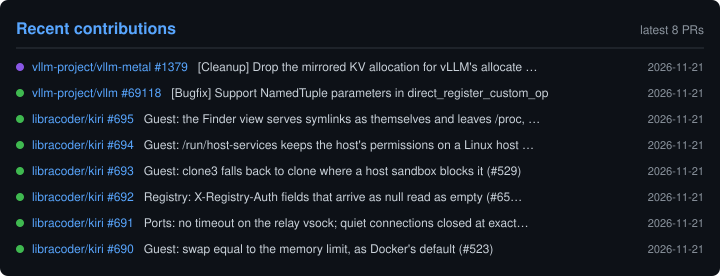

<!-- ============================================ -->
<!--  GitHub Profile README for mitsa-ng (Nati)   -->
<!--  Version française · défaut : README.md      -->
<!-- ============================================ -->

[繁體中文](./README.md) · [English](./README.en.md) · [日本語](./README.ja.md) · **Français**

 

## À propos

- Focalisé sur les **systèmes full-stack**, l'**IA embarquée** et les **jeux multijoueurs** ; en ce moment : écrire un navigateur en Rust à partir de zéro (**surf**) et réécrire Project-Eat en Rust
- **La vie privée est une fonctionnalité, pas un réglage** : ce qui peut tourner sur l'appareil reste sur l'appareil (pdiary)
- Devise : **livrer d'abord, peaufiner ensuite**. 28 dépôts publics, dont 5 avec démo en ligne ; **1 599** problèmes LeetCode résolus (#6 543)

 

## Contributions récentes

Liste complète : [PR de mitsa-ng (hors dépôts personnels)](https://github.com/pulls?q=is%3Apr+author%3Amitsa-ng+-user%3Amitsa-ng). La carte est actualisée toutes les six heures par [GitHub Actions](./.github/workflows/contributions.yml).

 

## Projets phares

- **[surf](https://github.com/mitsa-ng/surf)** : un navigateur écrit en Rust à partir de zéro `Rust`
- **[pdiary](https://github.com/mitsa-ng/pdiary)** : journal vocal IA axé confidentialité, de la transcription au chiffrement, entièrement sur l'appareil `Flutter` `llama.cpp`
- **[mcgit](https://github.com/mitsa-ng/mcgit)** : contrôle de version pour les sauvegardes de serveurs Minecraft `Python` `Postgres`
- **[OmniBoard](https://github.com/mitsa-ng/OmniBoard)** : tableau full-stack TypeScript + Rust · [live](https://omniboard-app.vercel.app)

Les 24 autres dépôts : [github.com/mitsa-ng?tab=repositories](https://github.com/mitsa-ng/?tab=repositories)

 

## Stack technique

**langages**

**IA embarquée & sécurité**

   

 

## Activité GitHub

 

## Contact

Issues et PR bienvenues sur tous les dépôts ; ouvert aux opportunités professionnelles et collaborations, télétravail bienvenu.
  

