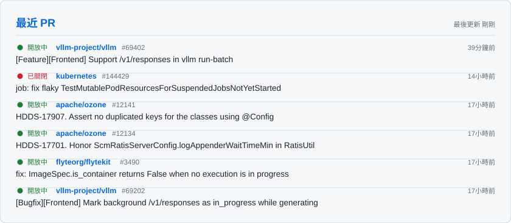

# 嗨，我是 Nati（mitsa-ng）

**繁體中文** · [English](./README.en.md) · [日本語](./README.ja.md) · [Français](./README.fr.md)

台灣的在學開發者。白天寫 TypeScript 全端，晚上玩 Rust。目前深入研究
**開源基礎架構**：虛擬化、備份機制與 WAF 規則評測。我的學習方式是把
系統的內部機制，用小而零依賴的程式碼重新實作一次。

## 基礎架構工具集

| 專案 | 做什麼 | 技術 |
|---|---|---|
| [chunk-vault](https://github.com/mitsa-ng/chunk-vault) | 內容定義分塊備份庫：gear-hash CDC、SHA-256 分塊儲存、驗證、GC（把 Proxmox BS 式去重從內部實作一次） | Python，僅標準庫 |
| [pve-audit](https://github.com/mitsa-ng/pve-audit) | Proxmox VE 備份涵蓋稽核：找出沒有任何啟用中 vzdump 作業保護的 guest；走真實 PVE API token 與 `/api2/json` | Python，僅標準庫 |
| [crs-check](https://github.com/mitsa-ng/crs-check) | ModSecurity SecRule 離線解析與評測：不用架網頁伺服器，看 OWASP CRS 式規則對請求的觸發結果 | TypeScript，零依賴 |

每個 repo 都附帶可在無網路環境執行的測試。

## 也做過：醫療互通工具集

三件零依賴 FHIR 工具：[fhir-lens](https://github.com/mitsa-ng/fhir-lens)（R4 驗證器＋client）、
[smart-launch](https://github.com/mitsa-ng/smart-launch)（SMART on FHIR＋PKCE）、
[hl7v2-fhir-bridge](https://github.com/mitsa-ng/hl7v2-fhir-bridge)（HL7 v2 轉 R4）。

## 系統與 side projects

- **surf**：以 Rust 從零打造的瀏覽器
- **nanollm**：C++17 極簡 LLM 推理執行環境，可跑 Qwen2.5 全鏈路
- **pdiary**：隱私優先語音日記，llama.cpp 端內轉錄
- **mcgit**：帶分散式鎖的 Minecraft 世界存檔同步

## 目前在學

Proxmox VE 管理、ZFS、備份策略（3-2-1、pull-mode 隔離）、ModSecurity/OWASP
CRS 調校、Debian 伺服器維運。

## 最近 PR

<picture>
  <source media="(prefers-color-scheme: dark)" srcset="./assets/recent-prs.svg">
  
</picture>

[查看全部 →](https://github.com/pulls?q=is%3Apr+author%3Amitsa-ng+sort%3Aupdated-desc)

## 聯絡

- GitHub：你正在這裡
- [個人網站](https://mitsa.dpdns.org/zh-TW)

**給招募者**：[履歷（PDF，繁中）](./resume.pdf)
開源基礎架構工程師（虛擬化／備份／資安），在學、可實習或全職面談
